# Dissonance

  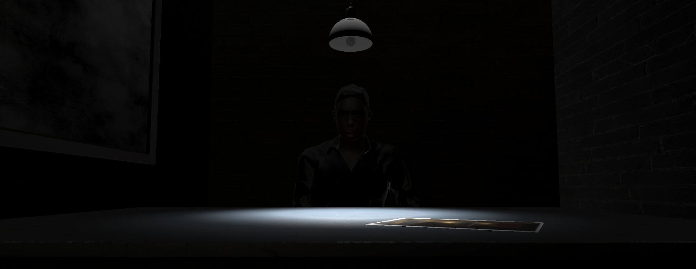

**Interactive VR short film for Meta Quest 3 using Unity 6, combining cinematic sequences with hand-tracked, roomscale interactions and real-world player movement between seated and standing experiences.**

## Overview
**Engine** Unity |  **Platform** Meta Quest 3 | **XR** XR Interaction Toolkit | **Input** Hand Tracking / Controllers | **Development time** ~4 months | **Type** Solo Student Project

Dissonance is a single-player interactive short film in virtual reality intended for standalone Meta Quest 3.

The experience alternates between cinematic sequences and interactive gameplay, allowing the player to be an active part of the narrative rather than a spectator. No conventional UI is used during gameplay to preserve immersion.

Interactions are designed for Hand Tracking and Roomscale, but the use of controllers is still possible. Scene layouts take into account spatial continuity of the player's position and orientation including matching the virtual seating to the real-world chair.

The story, characters and dialogues were entirely written for the project, with the interactive structure designed around the narrative.

[Read the full scenario](Docs/Dissonance_Scenario.pdf)

## Technical Highlights
### Timeline-Driven Narrative
**Unity Timeline** orchestrates the cinematic and interactive sequences by pausing when an interaction is expected. InteractionSystem receives the signal from the timeline and waits for the correct interaction before resuming the timeline.

**Alternative timeline** is a special case where the player has multiple possible interactable objects to interact with at the same timeline point. Depending on the interaction, it can either resume the initial timeline or play an alternative timeline from the same or different scene.

**Timeline Starting point** can be configured to create flashbacks in other scenes and return to a defined point in the original timeline.

**Interaction Timeout** is set up to prevent the narrative from being blocked, if the player fails to perform the awaited interaction within a defined time limit, the timeline automatically resumes after the countdown.

### Scene and Timeline Management
**ScenesManager** is a singleton persistent across all scenes. It allows scenes to be changed by name, while also selecting which timeline to play and its starting point. It communicates with **TimelineController**, which references and handles the timelines of each scene.

**SceneEvents** serves as a relay between Timeline Signals and ScenesManager. It also activates or deactivates visible objects depending on the timeline.

**TransitionManager** handles scene transitions using fade-in and fade-out effects.

  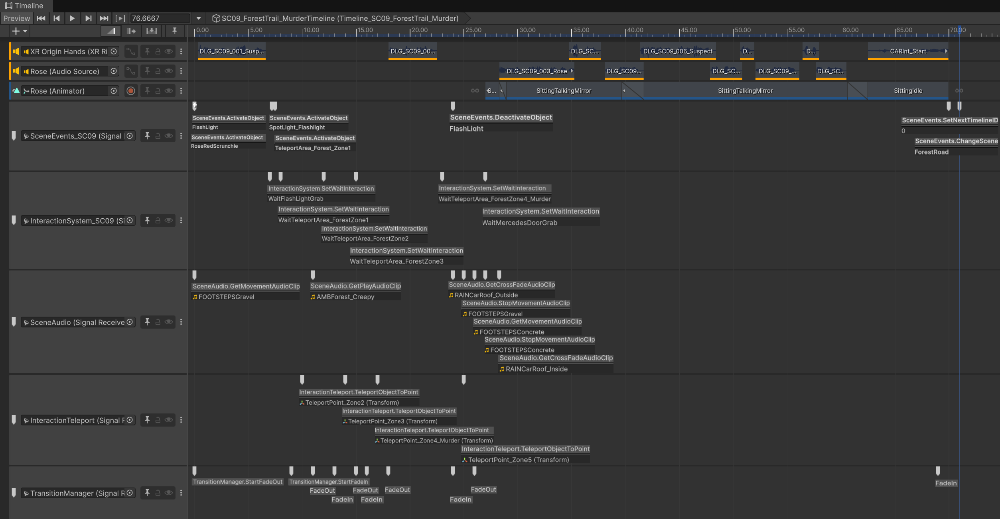

### Interaction System
**InteractionHandler** is placed on interactable objects. It detects the player's interactions and sends them to the InteractionSystem.

**InteractionSystem** also receives awaited interactions from the Timeline. It verifies whether the performed interaction corresponds to the expected one. It can manage simple interactions or a sequence of interactions. It then allows the Timeline to resume upon correct interaction.

### Custom VR Interactions
**InteractionHandler** defines several custom interaction types for each interactable object based on XR Interaction Toolkit and Unity methods.

**InteractionMovement** applies movement behaviors to interactables for specific interactions.

<table>
  <tr align="center">
    <th>Interaction</th>
    <th>Description</th>
  </tr>
  <tr>
    <td> Press   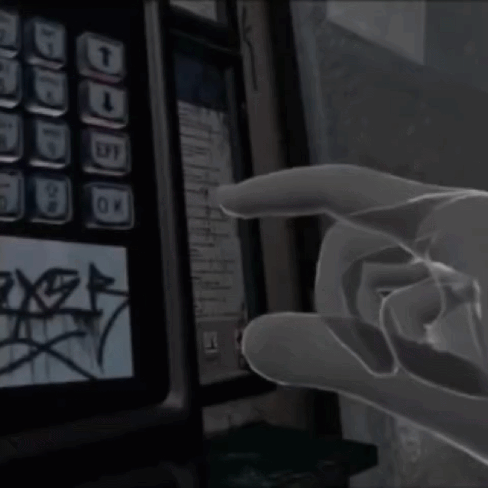 
    </td>
    <td>The player points at an interactable. The Press movement then moves the object in the direction of the poke interaction, with a linear back and forth movement along an axis.
    </td>
  </tr>
  <tr>
    <td> Grab   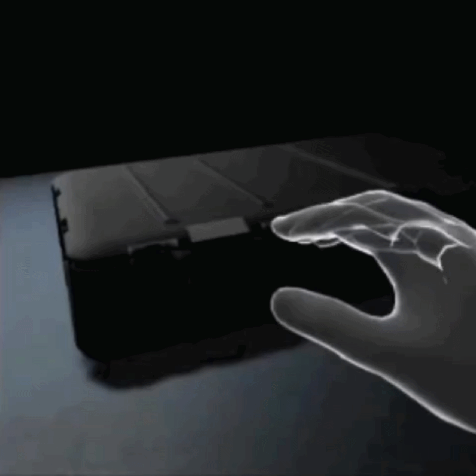
    </td>
    <td>The player grabs an object, which is then held at an attach point. A Pivot movement can also be configured around a rotation axis, allowing the interactable to rotate according to the movement of the player's hand around the pivot.
    </td>
  </tr>
  <tr>
    <td> Hover   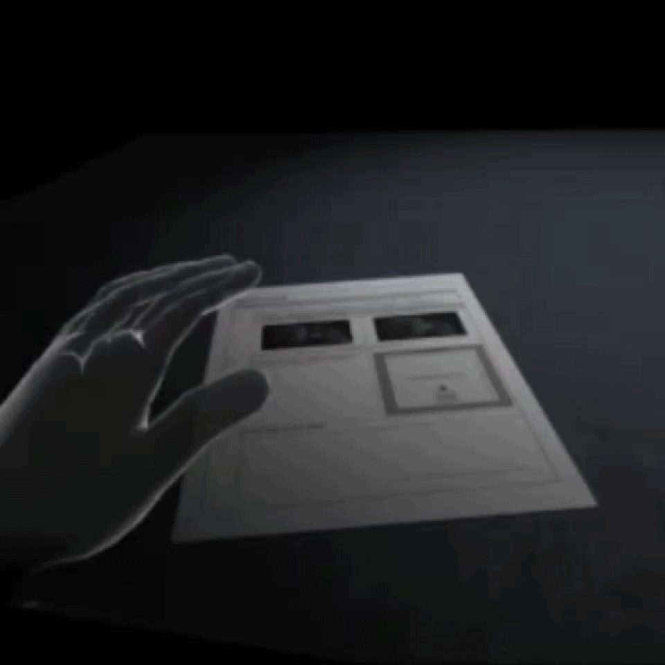
    </td>
    <td>The player selects an interactable using near detection. A minimum hover duration is set to make sure the player has not accidentally chosen an object.
    </td>
  </tr>
  <tr>
    <td> Zone   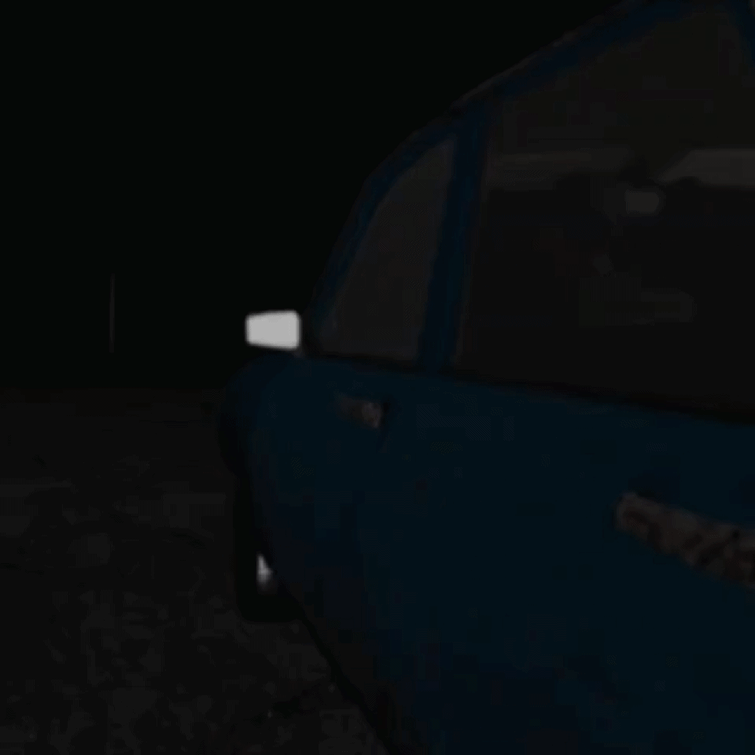
    </td>
    <td>The player or other interactable enters a trigger zone, detected using a specific Zone tag.
    </td>
  </tr>
  <tr>
    <td> LookAt   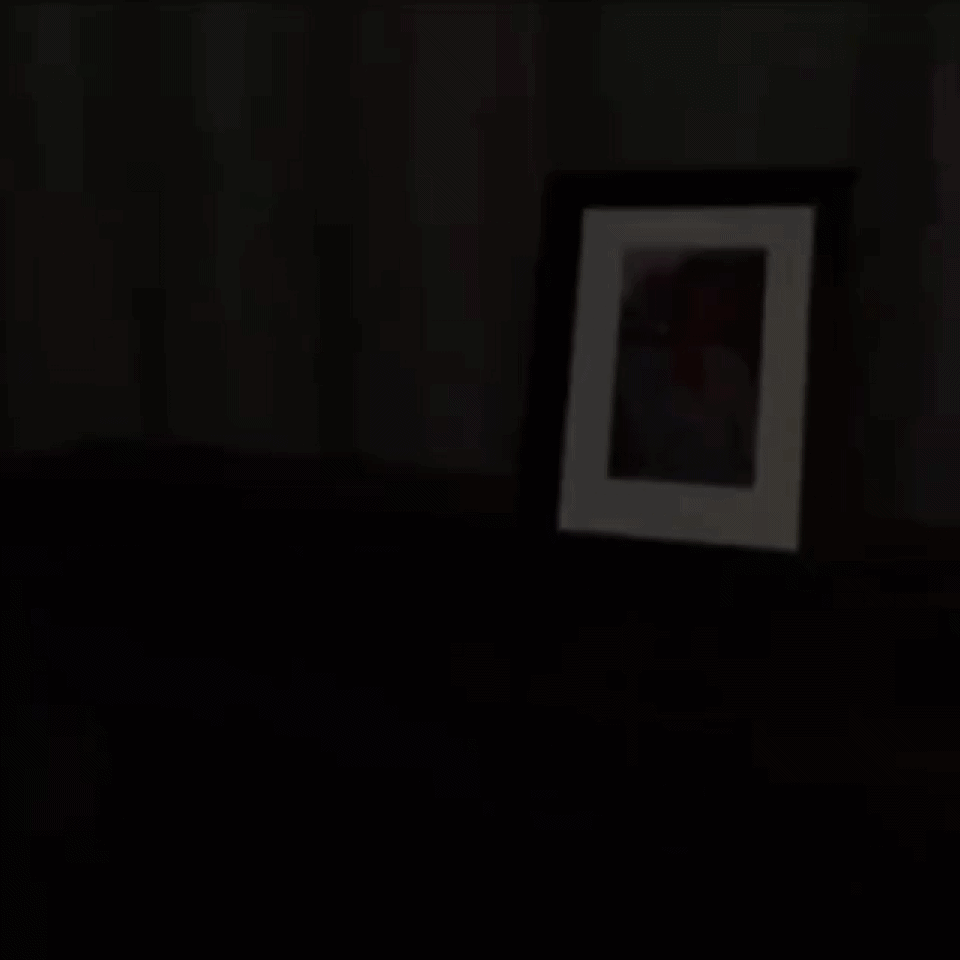
    </td>
    <td>The player's camera looks at an interactable within a defined viewing angle. The system compares the forward direction of the camera with the direction toward the interactable.
    </td>
  </tr>
</table>

### Spatial Teleport and Roomscale
The experience uses the player's real-world position and orientation as part of the interaction system. The first and last interactions of each Timeline are positioned to match the next scene so the player remains at the same physical position during scene transitions.

Interaction Zones are placed for the player to be close to the next interaction or in a specific area required for the next scene.

Scene Layouts are arranged to fit the actual Roomscale space. Scene objects are positioned and oriented accordingly.

Virtual seating or standing positions correspond to the player's physical positions. Virtual seats are always aligned with the real-world chair. The player can then stand and walk around the chair in the roomscale space before being guided back to the chair to sit down.

**InteractionTeleport** repositions the player at different points within the same scene. This creates visual continuity of walking through the environment by moving between teleport checkpoints. It also routes the player through accessible roomscale space when turning corners or returning to desired points, such as the chair, without reaching the physical space boundaries.

  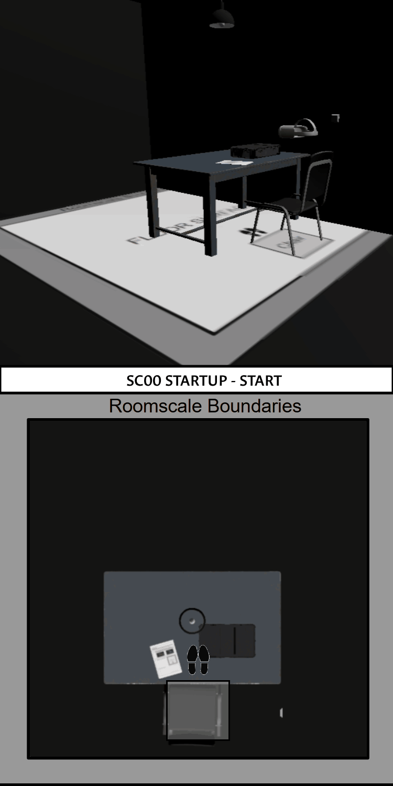

### Audio System and Ambisonic Sound
**SceneAudio** can be called by Timeline Signals to play, stop or crossfade audio clips for ambient sounds or music in a scene. It also activates the player's movement sound while walking in certain areas.

**InteractionAudio** provides audio feedback for Press, Grab and Zone interactions when an audio clip is defined.

**Ambisonic sounds** are implemented for realistic spatialization and are also part of the gameplay in blindfolded scenes where the player must recognize the layout and position of objects by ear.

**NPC voices** are generated using AI Voice Design and are created with selected adjectives to shape each character's personality. Dialogues are generated with TextToSpeech and inserted into the Timeline, alternating between NPC conversations and speeches directed at the player, who also has a voice and scripted dialogue.

### Architecture
The Architecture is organized around two main flows: the Narrative Flow and the Interactive Flow connecting the Timeline and the Player through signals - - - >.

  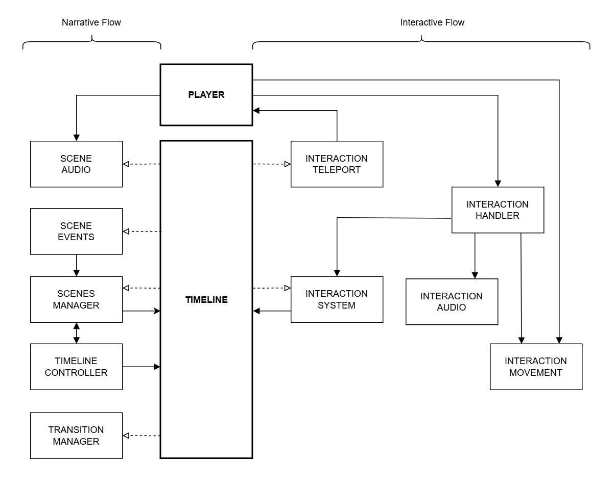

### Performance & Optimization
| Step | Description |
|---|---|
| **Problem** | Frame drops causing visible stuttering during the experience. |
| **Investigation** | **Unity Profiler** was used to identify performance spikes and when they occurred. Debug logs were also added to correlate spikes with runtime events. |
| **First Solution** | Enabling `Preload Audio Data` with `Decompress on Load` removed the in-game stuttering, but significantly increased scene loading times. |
| **Root Cause** | Large audio files were being loaded and decompressed, causing performance spikes during runtime. |
| **Final Solution** | Long audio clips (> 7 MB) were switched to `Streaming` Load Type instead of `Decompress on Load`, avoiding loading the entire file into memory at once and consuming excessive RAM. |
| **Result** | The experience maintains an average frame time of 13-14 ms on Meta Quest 3, reaching approximately **72 FPS**.

## Technologies & Tools
<table align="center">
  <tr>
    <td align="center">
      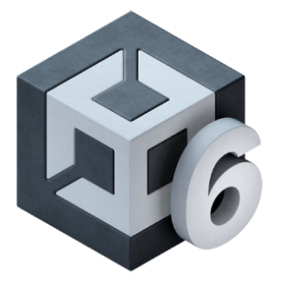 
      Unity 6
    </td>
    <td align="center">
       
      GitHub
    </td>
    <td align="center">
       
      Blender
    </td>
    <td align="center">
       
      Photopea
    </td>
    <td align="center">
       
      Mixamo
    </td>
  </tr>
  <tr>
    <td align="center">
       
      Reaper
    </td>
    <td align="center">
       
      KikiVoice
    </td>
    <td align="center">
       
      WriterDuet
    </td>
    <td align="center">
       
      Jira
    </td>
    <td align="center">
       
      Google Sheets
    </td>
  </tr>
</table>

## Build
**Latest Release:** Dissonance_v1.0 - [Download the latest Meta Quest 3 build]()

## Setup & Requirements
- **Headset:** Meta Quest 3
- **Language:** French
- **Play Area:** Minimum clear floor area of 3 m², with a slightly larger Roomscale boundary to allow head and hand movement beyond the playable floor area while keeping the player's feet within it.
- **Interaction:** Hand Tracking recommended, controllers supported.
- **Physical Setup:** A real chair is required for seated sequences. It must be centered along the back boundary of the play area, with a ~20 cm offset from the boundary.
- **Duration:** 30~45min

  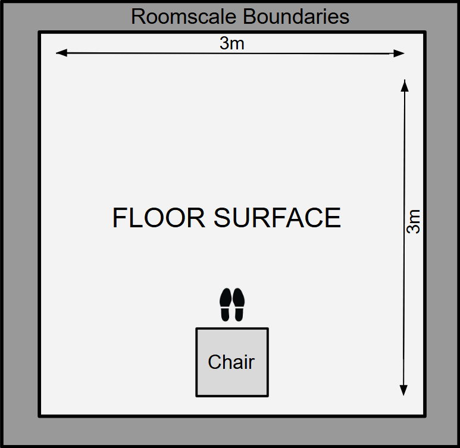

